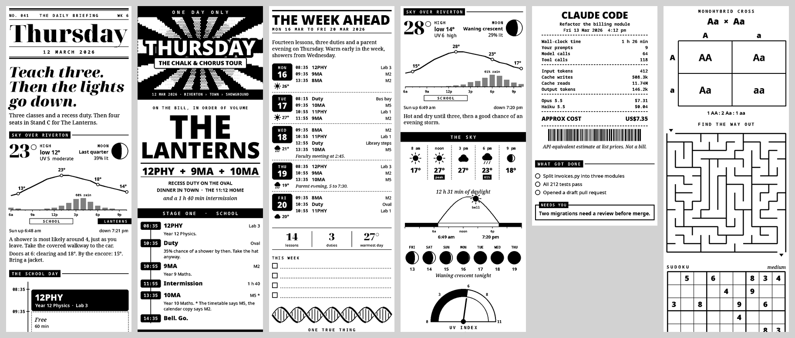
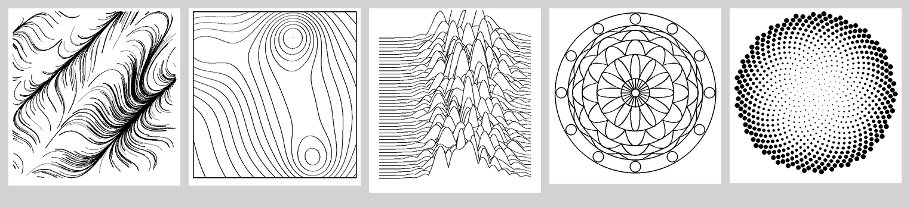

# tearoff

**Give your AI agent a receipt printer.**

A thermal receipt printer is cheap, needs no ink, and cuts its own paper. Put one on your network, point an agent at it, and things you
would otherwise have to remember to look at simply appear on your desk: this
morning's briefing, the week ahead, a shopping list sorted by aisle, a receipt for
the long job your agent just finished.

tearoff is a small Python library of things worth printing, packaged as an agent
skill for [Hermes Agent](https://github.com/NousResearch/hermes-agent) and Claude
Code. The agent supplies facts and words. It never has to draw.



Everything above is real output, 576 dots wide, exactly as it comes off the printer.

## What it prints

| | |
|---|---|
| **Daily briefing** | Two complete layouts, [newspaper](docs/gallery/newspaper.png) and [gig poster](docs/gallery/gig-poster.png), driven by one JSON file: timetable to scale, weather curve over rain bars, to-dos, a ticket stub for tonight, a fun fact. |
| **Week ahead** | [One block per day](docs/gallery/week-ahead.png) with classes or meetings, duties and the forecast. |
| **Job receipt** | When a long agent session ends (Claude Code or Hermes): [time, tool calls, tokens and approximate cost](docs/gallery/job-receipt.png), read from the session's own records. |
| **Lists** | To-do lists, and [shopping lists that sort themselves into supermarket aisles](docs/gallery/shopping-list.png). Meal plans that come with their shopping list on a separate cut. |
| **Weather** | [Hourly chart, icon row, sun arc, moon for the week, UV gauge, sparklines](docs/gallery/weather.png). |
| **Classroom** | Exit tickets, bingo cards, Punnett squares, cryptograms, word searches from your vocabulary list, merit tickets, sudoku. |
| **Around the house** | Recipe cards, score pads, wifi cards with a QR code, labels, coupons, banners, a ruler, paper chains, photos. |
| **Just for looking at** | Generative art, different for every seed. |



There are 59 widgets in all. [`skills/tearoff/references/widgets.md`](skills/tearoff/references/widgets.md)
lists every one with a working JSON example, and the `sampler-*.png` files in
[`docs/gallery/`](docs/gallery/) show them all.

## Install

You need Python 3.10+, [Pillow](https://python-pillow.org/), and the Noto fonts
(`noto-fonts` on Arch, `fonts-noto` on Debian and Ubuntu). `numpy` is used by one
art style and `qrencode` by the QR and wifi widgets; both are optional.

**Hermes Agent**

```bash
hermes skills install bennybuoy/tearoff/skills/tearoff     # from GitHub
# or, from a clone:
./install.sh hermes
```

The skill declares its settings (printer address, paper width, location), so
`hermes config migrate` will ask for them. It is also a blueprint: after
installing, `/suggestions` offers a school-day 6:30 am briefing as a cron job. You
accept it or dismiss it; nothing is scheduled without you. The skill passes
Hermes's install-time security scan with a `safe` verdict.

**Claude Code**

```bash
./install.sh claude          # copies the skill to ~/.claude/skills/tearoff
```

**Plain command line**

```bash
git clone https://github.com/bennybuoy/tearoff && cd tearoff
bin/tearoff setup --printer 192.168.1.50      # your printer's address
bin/tearoff test                              # prints an alignment strip
```

Then say "print my day", "print a shopping list: milk, bananas, two avocados" or
"give me a receipt for that" to your agent, or print things yourself:

```bash
bin/tearoff quick shop Milk Bananas "2 avocados" "Tinned tomatoes" --print
bin/tearoff quick banner "HAPPY BIRTHDAY" --print
bin/tearoff quick art flow --seed 5 --print
bin/tearoff newspaper --edition skills/tearoff/examples/newspaper-event-day.json --print
bin/tearoff strip --spec skills/tearoff/examples/week-ahead.json --print
```

No printer yet? Everything renders to PNG:

```bash
bin/tearoff quick todo "Saturday" "Mow the lawn" "Bins out" --out todo.png
tests/smoke.sh                                # renders every example and widget
```

## How an agent uses it

A print is a JSON list of widgets, top to bottom. `{"type": "cut"}` ends a piece
of paper.

```json
{"date": "2026-03-13", "widgets": [
  {"type": "masthead", "issue": 5},
  {"type": "headline", "lines": ["Three classes,", "one long lunch."]},
  {"type": "weather_chart", "...": "pasted from `tearoff facts`"},
  {"type": "checklist", "items": ["Bus bay duty at 8:15", "Collect the parcel"], "blank": 2},
  {"type": "fact", "text": "Outdoor light, even under cloud, is far brighter than a classroom."},
  {"type": "signoff", "text": "Have a good Friday."}
]}
```

The agent gathers the facts (calendar, inbox, weather), copies widget examples
from the widget reference, fills in the words, renders previews, looks at them, and
prints. The loop that matters is **render, look, fix, print**: `--preview-dir`
writes PNG slices the agent can read before any paper moves.

Three things make this work with small, cheap models:

- **Content is separate from layout.** The model writes JSON; the scripts draw.
- **Computed facts come from scripts.** `tearoff facts` returns the forecast, moon
  phase and day counts ready to paste. `tearoff week` builds the week from your
  timetable. `tearoff receipt` reads token counts from the transcript. The model
  is never asked to do arithmetic or recall weather.
- **Failures are loud.** Printing checks the printer first and says `NOT PRINTED`
  or `PRINT FAILED` in capitals instead of pretending. Placeholder text left in a
  spec stops the render.

### One skill, two agents

[`skills/tearoff/`](skills/tearoff/) is a self-contained skill folder: `SKILL.md`,
the scripts, the widget and edition references, and example files. Hermes loads it
natively (frontmatter with config, tags and a blueprint schedule). Claude Code
reads the same `SKILL.md`. The "Where the facts come from" section is deliberately
generic; edit your installed copy to name your own calendar and mail tools.

It has been run end to end with small models: Claude Haiku built and checked a
full daily briefing unattended in about 75 seconds.

### Job receipts

At the end of a long session:

```bash
bin/tearoff receipt --print --title "Refactor the billing module" \
  --did "Split invoices.py into three modules" --did "All 212 tests pass" \
  --attention "Two migrations need a review before merge"
```

In Claude Code, time, calls and tokens come from the session transcript in
`~/.claude/projects/`, and cost is tokens multiplied by the list prices in
`skills/tearoff/scripts/prices.json`: an API-equivalent estimate, not a bill.
Update that file when prices change.

In Hermes, add `--hermes <session id>` (the skill passes the current one). The
numbers and the cost come from Hermes's own session records, read-only.

### Unattended: the morning print

In Hermes, accept the blueprint from `/suggestions` and the cron scheduler does
the rest. For Claude Code, `automation/morning.sh` runs a headless agent that
builds and prints the day's briefing, and `automation/install.sh on 06:30` sets up
systemd timers for school days and a Sunday week-ahead.

Read the script before you switch it on. An agent that reads your inbox while
nobody is watching can be steered by whatever an email says, so the script gives
it a short allow-list: read calendars and mail, run tearoff's own scripts, write
edition files, nothing else. The worst a hostile email can do is produce a strange
piece of paper. Keep it that way if you extend it.

## Hardware

Any ESC/POS receipt printer with a network port should work: tearoff sends plain
`GS v 0` raster images to TCP port 9100 and asks for status with `DLE EOT`.
Developed on a generic 80 mm printer that identifies as an Epson TM-T88 type.

- 80 mm paper is 576 dots wide (some printers use 512); 58 mm paper is 384. Set it
  with `tearoff setup --width`. Layouts scale with the width.
- Everything is sent as an image, so the printer's own fonts do not matter.
- Black and white only. "Grey" is a dot pattern.
- Thermal paper fades in sunlight and heat. This is for today's paper, not the
  archive.
- USB-only printers are not supported yet. A print server or a small
  network-to-USB bridge works.

## Configuration

`~/.config/tearoff/config.json`, written by `tearoff setup`:

```json
{
  "printer_host": "192.168.1.50",
  "width": 576,
  "place": "LONDON", "lat": 51.51, "lon": -0.13,
  "masthead": "THE DAILY BRIEFING",
  "schedule_cmd": "python3 ~/bin/my_timetable.py --json"
}
```

`schedule_cmd` is optional: any command that prints your timetable as a JSON list
of `{"start": "2026-03-16T08:35:00", "class_code": "12PHY", "location": "Lab 3"}`.
The week-ahead builder uses it. `TEAROFF_PRINTER` and `TEAROFF_WIDTH` override the
file. Weather comes from [Open-Meteo](https://open-meteo.com/), free and keyless.

## Layout of the repo

```
skills/tearoff/              the skill: everything an agent needs
  SKILL.md                   instructions (Hermes and Claude Code)
  scripts/tearoff.py         one command for everything
  scripts/briefing.py        drawing kit, printer I/O, newspaper layout
  scripts/briefing_gig.py    gig-poster layout
  scripts/widgets.py         the 59 widgets and the strip renderer
  scripts/quick.py           one-line prints
  scripts/facts.py           weather and day facts
  scripts/week_ahead.py      week-ahead builder
  scripts/job_receipt.py     session receipts (Claude Code and Hermes)
  references/                widget reference, edition reference
  examples/                  edition and strip files to copy
bin/tearoff                  wrapper for the command line
install.sh                   copy the skill into Hermes or Claude Code
automation/                  unattended Claude Code run and timers
docs/gallery/                real output
tests/smoke.sh               renders everything, no printer needed
```

## Adding a widget

A widget is one function in `skills/tearoff/scripts/widgets.py`:

```python
@widget("my_widget", "fun", "One sentence an agent can act on.",
        {"text": "a complete working example"})
def w_my_widget(S, o, ctx):
    S.text(S.W / 2, S.y, o["text"], S.f("bold", 24), anchor="ma")
    S.y += S.s(34)
```

`S` is the sheet: `S.y` is the cursor, `S.s(n)` scales a 576-dot measurement to
the paper width, `S.f(name, size)` is a font, `S.d` is a Pillow `ImageDraw`. The
example dict is the documentation, the sampler entry and the smoke test, so make
it real. Regenerate the reference with
`bin/tearoff widgets --doc > skills/tearoff/references/widgets.md`.

## Licence

MIT.
